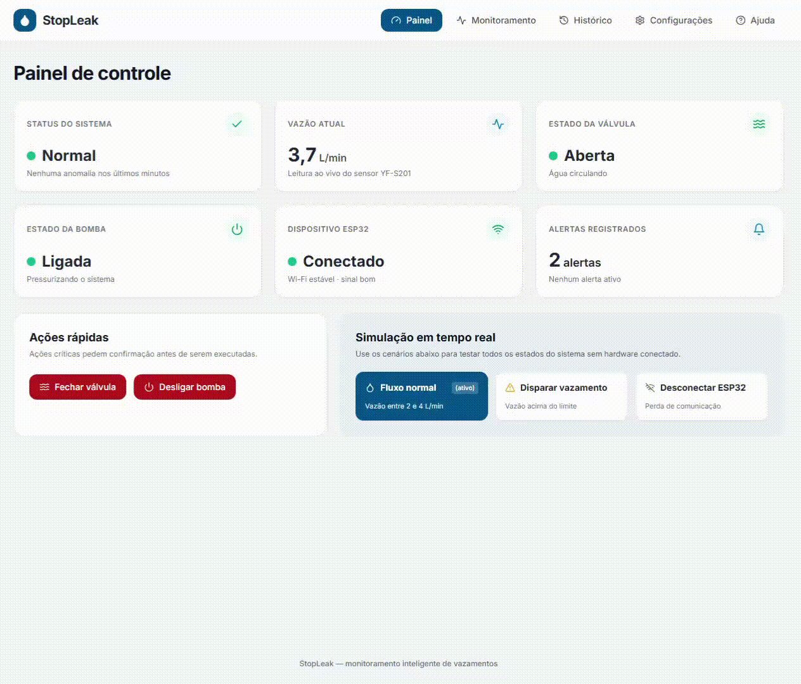
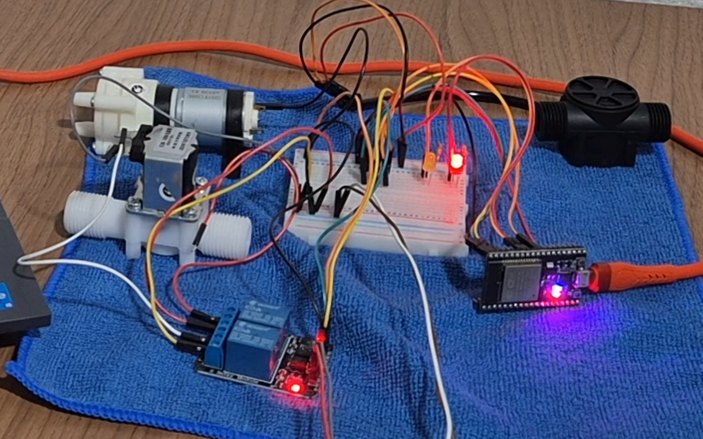

# 💧 StopLeak

<div align="center">
  StopLeak
  <p><strong>Sistema IoT inteligente para detecção de vazamentos de água em tempo real, telemetria web e bloqueio automático de fluxo.</strong></p>

  
  
  
  
</div>

<p align="center">
  <a href="#-sobre-o-projeto">Sobre</a> •
  <a href="#-principais-funcionalidades">Funcionalidades</a> •
  <a href="#-arquitetura-e-hardware">Arquitetura</a> •
  <a href="#-demonstração">Demonstração</a> •
  <a href="#-tecnologias-utilizadas">Tecnologias</a> •
  <a href="#-como-executar">Como Executar</a> •
  <a href="#-autores">Autores</a>
</p>

---

## 📋 Sobre o Projeto
O **StopLeak** é um sistema ciberfísico de Internet das Coisas (IoT) desenvolvido como Trabalho de Conclusão de Curso (TCC) para mitigar o desperdício hídrico e evitar danos estruturais causados por vazamentos em instalações hidráulicas residenciais e comerciais. 

A solução combina processamento de borda (*edge computing*) no microcontrolador **ESP32** com uma aplicação web de monitoramento contínuo. Ao identificar anomalias no padrão de vazão, o sistema emite alertas imediatos e aciona automaticamente o fechamento da rede hidráulica via válvula solenoide.

## ✨ Principais Funcionalidades
- 🎯 **Monitoramento de Vazão em Tempo Real:** Leitura contínua de fluxo hídrico utilizando sensores de efeito Hall (`YF-S201`) com tratamento via interrupções de hardware.
- ⚡ **Corte Automático de Abastecimento:** Acionamento imediato de válvula solenoide e bomba auxiliar por meio de módulos relé assim que uma anomalia ou vazamento é detectado.
- 📊 **Telemetria Web e Dashboard:** Interface responsiva para visualização do consumo instantâneo, histórico de vazão, status da válvula e controle remoto manual.
- 🔒 **Máquina de Estados Finitos (FSM):** Lógica embarcada resiliente para diferenciar o consumo normal de padrões contínuos de vazamento, evitando falsos positivos.

## 🔧 Arquitetura e Hardware
O protótipo físico é composto pelos seguintes módulos:
- **Microcontrolador:** ESP32 (processamento local e comunicação Wi-Fi / WebSockets / HTTP)
- **Sensores:** Sensor de fluxo de água de efeito Hall `YF-S201`
- **Atuadores:** Válvula solenoide hidráulica e bomba auxiliar
- **Acionamento:** Módulos relé optoacoplados

## 🎬 Demonstração

### Screenshots e Protótipo
tela principal do dashboard onde fica as funções principais do funcionamento do sistema:

<div align="center">
  
</div>
imagem do ultimo prototipo testado em banca:
<div align="center">
  
</div>

## 🛠️ Tecnologias Utilizadas

**Firmware & Embarcados**
- 
- 
- 

**Frontend & Cloud**
- 
- 
- 
- 

**Ferramentas**
- 
- 

## 🚀 Como Executar

### 📦 Pré-requisitos
- [Arduino IDE](https://www.arduino.cc/en/software) ou **ESP-IDF** para gravação do firmware no ESP32
- Git instalado

### 💻 Rodando a Interface Web (Frontend)
1. Clone o repositório:
```bash
git clone [https://github.com/Gus1avo/Stopleak.git](https://github.com/Gus1avo/Stopleak.git)